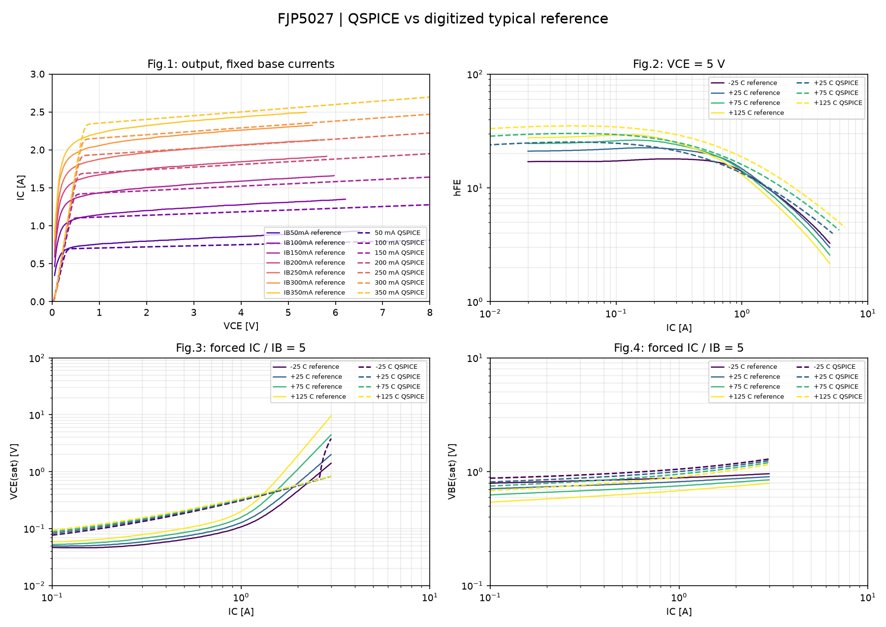
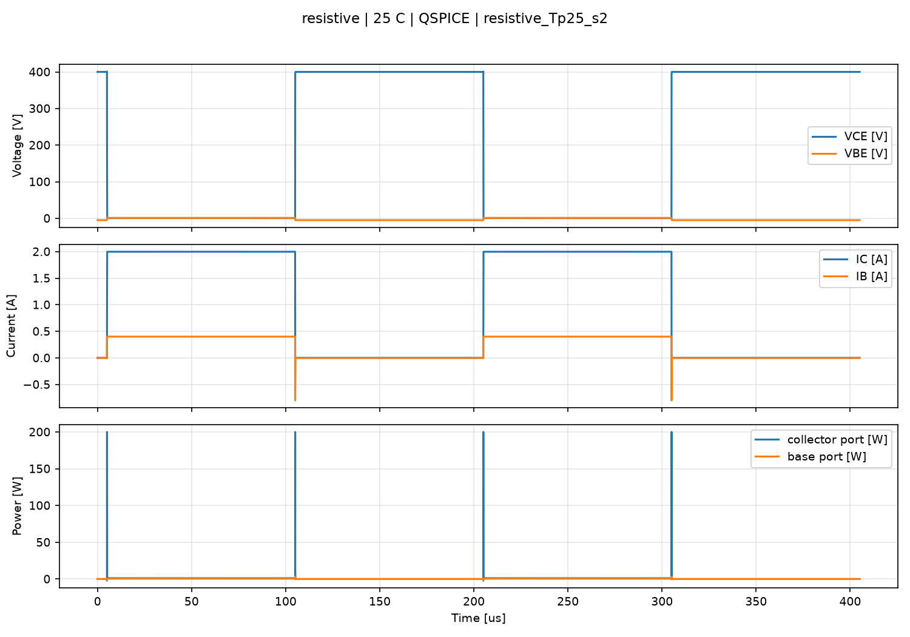
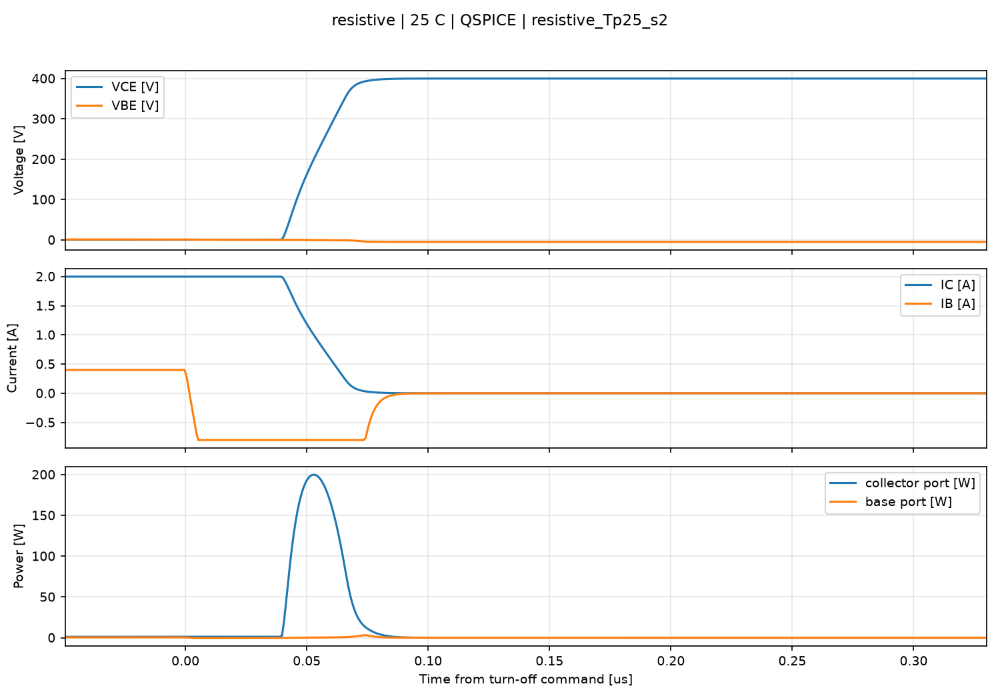
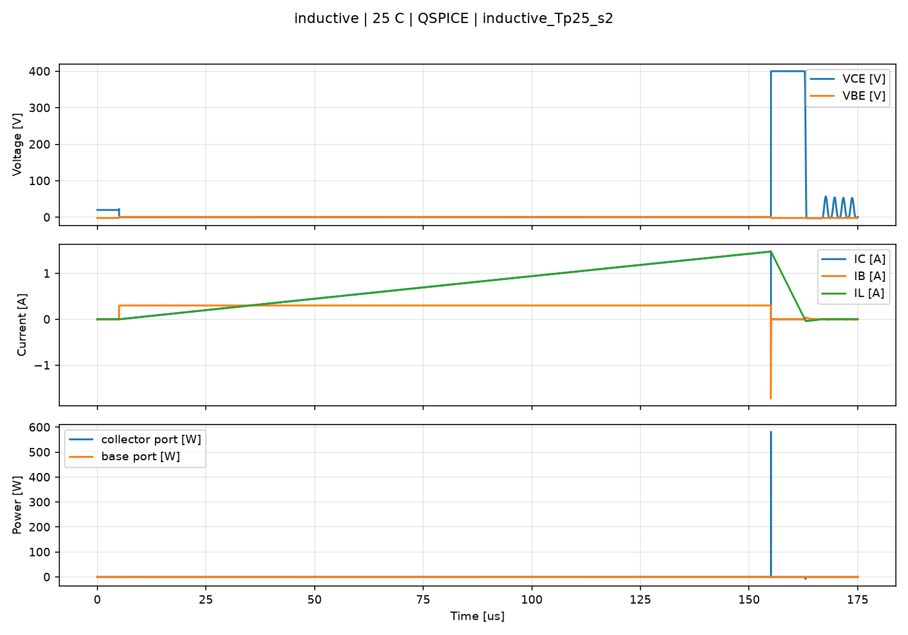
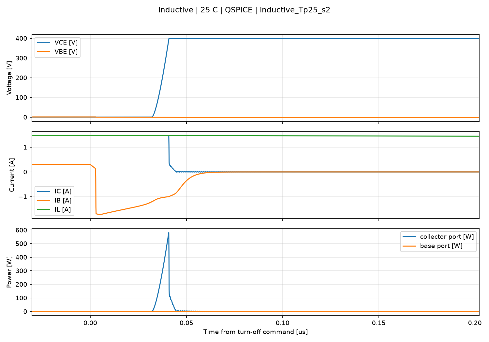
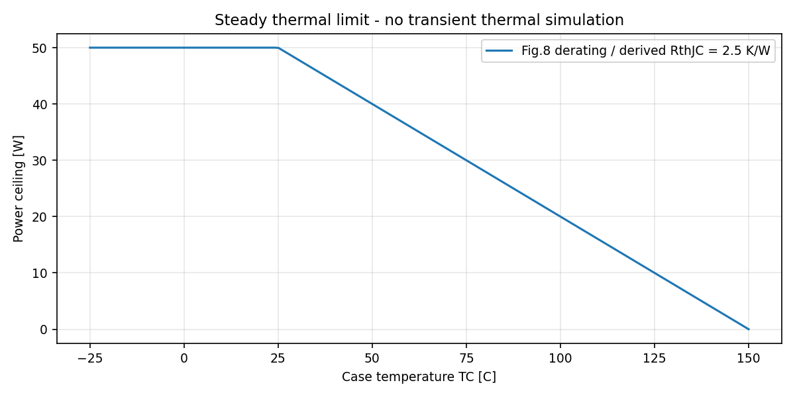

# FJP5027: сравнение модели с даташитом

**Результат: INVALID_OR_INCOMPLETE.**

Модель: `FJP5027_CANDIDATE_V1`; статус: **STARTING_CANDIDATE_NOT_CALIBRATED**.
Это начальная модель-кандидат. Даже успешное сравнение типовых кривых не доказывает полное соответствие всех экземпляров, SOA и всех режимов.

Рассчитано QSPICE: **27 / 28** случаев. Режим: `QSPICE`.

Сплошные линии: оцифрованный векторный PDF Fairchild Rev.A, December 2003. Пунктир: только реальные результаты QSPICE, если расчёт выполнен.
Кривые не сглаживаются и не подменяются эталоном. На рисунках указаны физические величины и единицы, а не напряжения служебных B-мониторов.
Метрики рассчитаны по полному CSV до очистки. Компактные NPZ служат только для рисунков: сохраняются исходные точки с min/max каждой величины и отдельное окно выключения; новые значения не интерполируются при уплотнении.

## Сравнение типовых кривых

Критерий проекта: P95 относительной ошибки не выше допуска и покрытие не менее 95%. Это пользовательские критерии, не гарантия производителя. При калибровке на этих же кривых результат является качеством подгонки, не независимой проверкой.

| График | Кривая | T, C | Покрытие | RMS | P95 | Max | Допуск P95 | Статус |
|---|---|---:|---:|---:|---:|---:|---:|---|
| output | IB50mA | 25 | 100.000% | 23.828% | 62.073% | 83.489% | 10% | FAIL |
| output | IB100mA | 25 | 100.000% | 24.983% | 67.479% | 87.260% | 10% | FAIL |
| output | IB150mA | 25 | 100.000% | 26.340% | 71.358% | 90.643% | 10% | FAIL |
| output | IB200mA | 25 | 100.000% | 27.953% | 74.104% | 92.304% | 10% | FAIL |
| output | IB250mA | 25 | 100.000% | 29.662% | 76.852% | 94.222% | 10% | FAIL |
| output | IB300mA | 25 | 100.000% | 29.739% | 77.527% | 95.978% | 10% | FAIL |
| output | IB350mA | 25 | 100.000% | 30.088% | 77.989% | 96.514% | 10% | FAIL |
| vcesat | T-25 | -25 | 100.000% | 146.829% | 201.949% | 203.728% | 20% | FAIL |
| vbesat | T-25 | -25 | 98.684% | 19.388% | 29.578% | 34.755% | 10% | FAIL |
| gain | T+25 | 25 | 100.000% | 15.754% | 32.023% | 39.515% | 15% | FAIL |
| vcesat | T+25 | 25 | 100.000% | 122.495% | 171.669% | 173.767% | 20% | FAIL |
| vbesat | T+25 | 25 | 98.901% | 22.097% | 32.379% | 38.306% | 10% | FAIL |
| gain | T+75 | 75 | 100.000% | 36.443% | 78.819% | 93.829% | 15% | FAIL |
| vcesat | T+75 | 75 | 100.000% | 102.215% | 139.395% | 141.041% | 20% | FAIL |
| vbesat | T+75 | 75 | 99.029% | 25.358% | 36.215% | 42.164% | 10% | FAIL |
| gain | T+125 | 125 | 100.000% | 70.889% | 148.557% | 169.314% | 15% | FAIL |
| vcesat | T+125 | 125 | 100.000% | 81.213% | 108.013% | 109.751% | 20% | FAIL |
| vbesat | T+125 | 125 | 99.038% | 30.518% | 40.720% | 46.415% | 10% | FAIL |

## Табличные точки

| Проверка | Значение SI / указанные единицы | Min | Max | Статус | Основание |
|---|---:|---:|---:|---|---|
| hFE at Ic=0.2 A, Vce=5 V | 22.8738 | 10 | 40 | PASS | guaranteed table limit |
| hFE at Ic=1 A, Vce=5 V | 13.4162 | 8 | - | PASS | guaranteed table limit |
| VCEsat at Ic=1.5 A, Ib=0.3 A [V] | 0.444985 | 0 | 2 | PASS | guaranteed table limit |
| VBEsat at Ic=1.5 A, Ib=0.3 A [V] | 1.07169 | 0 | 1.5 | PASS | guaranteed table limit |
| ton from Ib 10% to Ic 90% [s] | 9.62201e-08 | 0 | 5e-07 | PASS | guaranteed table limit |
| storage from Ib zero crossing [s] | 4.0742e-08 | 0 | 3e-06 | PASS | table max; timing-start convention must be confirmed |
| collector fall 90-10% [s] | 2.40728e-08 | 0 | 3e-07 | PASS | guaranteed table limit |
| ton from Ib 10% to Ic 90% [s] | 9.62144e-08 | 0 | 5e-07 | PASS | guaranteed table limit |
| storage from Ib zero crossing [s] | 4.07457e-08 | 0 | 3e-06 | PASS | table max; timing-start convention must be confirmed |
| collector fall 90-10% [s] | 2.40767e-08 | 0 | 3e-07 | PASS | guaranteed table limit |
| ton from Ib 10% to Ic 90% [s] | 9.62218e-08 | 0 | 5e-07 | PASS | guaranteed table limit |
| storage from Ib zero crossing [s] | 4.076e-08 | 0 | 3e-06 | PASS | table max; timing-start convention must be confirmed |
| collector fall 90-10% [s] | 2.40748e-08 | 0 | 3e-07 | PASS | guaranteed table limit |
| Cobo [pF], 10 V, 1 MHz | 60.00014 | 48 | 72 | PASS | project +/-20% around 60 pF typical; NOT guaranteed range |

## Сходимость динамики

Сравниваются два самых мелких успешно рассчитанных шага при 25 C. Измерения QPOST выполнены по полному исходному QRAW до очистки временных файлов.

| Стенд | Метрика | Шаг грубее, с | Шаг мельче, с | Значение грубее | Значение мельче | Изменение | Статус |
|---|---|---:|---:|---:|---:|---:|---|
| resistive | T_STORAGE_IB | 1e-09 | 5e-10 | 4.07457e-08 | 4.076e-08 | 0.03508% | PASS |
| resistive | T_FALL_IC | 1e-09 | 5e-10 | 2.40767e-08 | 2.40748e-08 | 0.007892% | PASS |
| resistive | TON_IB | 1e-09 | 5e-10 | 9.62144e-08 | 9.62218e-08 | 0.007691% | PASS |
| resistive | P_TOTAL_AVG | 1e-09 | 5e-10 | 0.870151 | 0.870165 | 0.001609% | PASS |
| inductive | T_STORAGE_IB | 1e-09 | 5e-10 | 3.8119e-08 | 3.80679e-08 | 0.1342% | PASS |
| inductive | T_FALL_IC | 1e-09 | 5e-10 | 1.85603e-09 | 6.99014e-11 | 2555% | FAIL |
| inductive | E_OFF_WINDOW | 1e-09 | 5e-10 | 2.41285e-06 | 2.40719e-06 | 0.2351% | PASS |

### resistive

### inductive

## Температура и тепловые пределы

Прогоны .temp являются изотермическими: температура модели задаётся явно. На типовых кривых обозначено TC; равенство Tj=TC является допущением сравнения без саморазогрева.
Из Fig.8 выведено RthJC=(150-25)/50=2.5 K/W. Это стационарная оценка, не идентифицированная тепловая RC-цепь. В PDF нет Zth(t), поэтому Cth и переходный нагрев не выдуманы.

Для посчитанной периодической мощности можно оценить Tj при фиксированной TC; эта оценка не замыкает электротепловую обратную связь:

| Случай | Pcollector+Pbase, Вт | TC, C | Оценка Tj, C |
|---|---:|---:|---:|
| resistive_Tm25_s0 | 0.875994 | -25 | -22.81 |
| resistive_Tp25_s0 | 0.870121 | 25 | 27.1753 |
| resistive_Tp25_s1 | 0.870151 | 25 | 27.1754 |
| resistive_Tp25_s2 | 0.870165 | 25 | 27.1754 |
| resistive_Tp75_s0 | 0.868991 | 75 | 77.1725 |
| resistive_Tp125_s0 | 0.868606 | 125 | 127.172 |

## Область применимости

- Рис.1: 7 значений IB, 25 C принято по условиям по умолчанию; температура внутри рисунка не подписана.
- Рис.2: VCE=5 V; hFE строится по фактическому IC и IC/IB, не по V_SCAN.
- Рис.3 и 4: принудительный IC/IB=5. Заголовки рисунков в PDF неоднозначны; используются подписи осей.
- Табличное резистивное переключение: 400 V, 200 ohm, IB1=0.4 A, IB2=-0.8 A. Частота, фронт и отсчёт времени явно сохранены в случаях; определения времени нужно сверять при точной паспортной приёмке.
- CIL является диагностикой коммутации при заданном ограничении, не доказательством VCEX(sus), лавины или RBSOA.
- Fig.5 имеет оси IC/VCE и является границей переключаемого режима, несмотря на название Switching Time. Его нельзя сравнивать с временной осциллограммой.
- Fig.7 содержит две временные кривые без однозначной подписи каждой: автоматическое присвоение ts/tf и PASS не выполняются.
- fT, пробой, утечки при 800 V, вторичный пробой, ресурс и transient Zth не проверены этим набором.
- Энергия E_OFF_WINDOW: знаковый интеграл коллекторного порта за окно, не энергия всего дросселя и не автоматически истинное тепло кристалла.

## Случаи и диагностика

| Случай | Статус | Источник | Ошибка / замечание |
|---|---|---|---|
| output_Tp25_IB50mA | SIMULATED | QUX netlist of user QSCH | Full CSV manually deleted in v1; original metrics and existing figures retained |
| output_Tp25_IB100mA | SIMULATED | QUX netlist of user QSCH | Full CSV manually deleted in v1; original metrics and existing figures retained |
| output_Tp25_IB150mA | SIMULATED | QUX netlist of user QSCH | Full CSV manually deleted in v1; original metrics and existing figures retained |
| output_Tp25_IB200mA | SIMULATED | QUX netlist of user QSCH | Full CSV manually deleted in v1; original metrics and existing figures retained |
| output_Tp25_IB250mA | SIMULATED | QUX netlist of user QSCH | Full CSV manually deleted in v1; original metrics and existing figures retained |
| output_Tp25_IB300mA | SIMULATED | QUX netlist of user QSCH | Full CSV manually deleted in v1; original metrics and existing figures retained |
| output_Tp25_IB350mA | SIMULATED | QUX netlist of user QSCH | Full CSV manually deleted in v1; original metrics and existing figures retained |
| gain_Tm25 | INVALID | QUX netlist of user QSCH | SuiteError: QSPICE64.exe: exit 4294967295; see D:\2.github\QSPICElib\transistors\BJT\FJP5027\results\20261104T105532.891963Z\cases\gain_Tm25\simulator.stderr.log |
| saturation_Tm25 | SIMULATED | QUX netlist of user QSCH | Full CSV manually deleted in v1; original metrics and existing figures retained |
| resistive_Tm25_s0 | SIMULATED | QUX netlist of user QSCH |  |
| inductive_Tm25_s0 | SIMULATED | QUX netlist of user QSCH |  CSV ограничен по числу точек; субнаносекундный фронт оценивайте по QPOST/QRAW. |
| gain_Tp25 | SIMULATED | QUX netlist of user QSCH | Full CSV manually deleted in v1; original metrics and existing figures retained |
| saturation_Tp25 | SIMULATED | QUX netlist of user QSCH | Full CSV manually deleted in v1; original metrics and existing figures retained |
| resistive_Tp25_s0 | SIMULATED | QUX netlist of user QSCH |  |
| resistive_Tp25_s1 | SIMULATED | QUX netlist of user QSCH |  |
| resistive_Tp25_s2 | SIMULATED | QUX netlist of user QSCH |  |
| inductive_Tp25_s0 | SIMULATED | QUX netlist of user QSCH |  CSV ограничен по числу точек; субнаносекундный фронт оценивайте по QPOST/QRAW. |
| inductive_Tp25_s1 | SIMULATED | QUX netlist of user QSCH |  CSV ограничен по числу точек; субнаносекундный фронт оценивайте по QPOST/QRAW. |
| inductive_Tp25_s2 | SIMULATED | QUX netlist of user QSCH |  CSV ограничен по числу точек; субнаносекундный фронт оценивайте по QPOST/QRAW. |
| gain_Tp75 | SIMULATED | QUX netlist of user QSCH | Full CSV manually deleted in v1; original metrics and existing figures retained |
| saturation_Tp75 | SIMULATED | QUX netlist of user QSCH | Full CSV manually deleted in v1; original metrics and existing figures retained |
| resistive_Tp75_s0 | SIMULATED | QUX netlist of user QSCH |  |
| inductive_Tp75_s0 | SIMULATED | QUX netlist of user QSCH |  CSV ограничен по числу точек; субнаносекундный фронт оценивайте по QPOST/QRAW. |
| gain_Tp125 | SIMULATED | QUX netlist of user QSCH | Full CSV manually deleted in v1; original metrics and existing figures retained |
| saturation_Tp125 | SIMULATED | QUX netlist of user QSCH | Full CSV manually deleted in v1; original metrics and existing figures retained |
| resistive_Tp125_s0 | SIMULATED | QUX netlist of user QSCH |  |
| inductive_Tp125_s0 | SIMULATED | QUX netlist of user QSCH |  CSV ограничен по числу точек; субнаносекундный фронт оценивайте по QPOST/QRAW. |
| cap_Tp25 | SIMULATED | QUX netlist of user QSCH |  |

## Все измерения QPOST

| Случай | Метрика | Значение SI |
|---|---|---:|
| output_Tp25_IB50mA | OUTPUT_ID_MAX | 0.810019 |
| output_Tp25_IB100mA | OUTPUT_ID_MAX | 1.27725 |
| output_Tp25_IB150mA | OUTPUT_ID_MAX | 1.64175 |
| output_Tp25_IB200mA | OUTPUT_ID_MAX | 1.95068 |
| output_Tp25_IB250mA | OUTPUT_ID_MAX | 2.22341 |
| output_Tp25_IB300mA | OUTPUT_ID_MAX | 2.47012 |
| output_Tp25_IB350mA | OUTPUT_ID_MAX | 2.69699 |
| saturation_Tm25 | VCESAT_1P5 | 0.436908 |
| saturation_Tm25 | VBESAT_1P5 | 1.11933 |
| resistive_Tm25_s0 | T_STORAGE_CMD | 2.39875e-08 |
| resistive_Tm25_s0 | T_STORAGE_IB | 2.28208e-08 |
| resistive_Tm25_s0 | T_FALL_IC | 2.43077e-08 |
| resistive_Tm25_s0 | VCE_PEAK | 401.098 |
| resistive_Tm25_s0 | IB_REVERSE_PEAK | -0.8 |
| resistive_Tm25_s0 | TON_IB | 9.63385e-08 |
| resistive_Tm25_s0 | IC_ON | 1.99717 |
| resistive_Tm25_s0 | IB_ON_ACTUAL | 0.4 |
| resistive_Tm25_s0 | P_COLLECTOR_AVG | 0.639921 |
| resistive_Tm25_s0 | P_BASE_AVG | 0.236073 |
| resistive_Tm25_s0 | P_TOTAL_AVG | 0.875994 |
| inductive_Tm25_s0 | T_STORAGE_CMD | 2.98892e-08 |
| inductive_Tm25_s0 | T_STORAGE_IB | 2.75609e-08 |
| inductive_Tm25_s0 | T_FALL_IC | 2.44422e-11 |
| inductive_Tm25_s0 | VCE_PEAK | 400.019 |
| inductive_Tm25_s0 | IB_REVERSE_PEAK | -1.75126 |
| inductive_Tm25_s0 | IC_AT_COMMAND_OFF | 1.47658 |
| inductive_Tm25_s0 | E_OFF_WINDOW | 2.33011e-06 |
| gain_Tp25 | HFE_0P2 | 22.8738 |
| gain_Tp25 | HFE_1 | 13.4162 |
| saturation_Tp25 | VCESAT_1P5 | 0.444985 |
| saturation_Tp25 | VBESAT_1P5 | 1.07169 |
| resistive_Tp25_s0 | T_STORAGE_CMD | 4.19086e-08 |
| resistive_Tp25_s0 | T_STORAGE_IB | 4.0742e-08 |
| resistive_Tp25_s0 | T_FALL_IC | 2.40728e-08 |
| resistive_Tp25_s0 | VCE_PEAK | 401.092 |
| resistive_Tp25_s0 | IB_REVERSE_PEAK | -0.8 |
| resistive_Tp25_s0 | TON_IB | 9.62201e-08 |
| resistive_Tp25_s0 | IC_ON | 1.99716 |
| resistive_Tp25_s0 | IB_ON_ACTUAL | 0.4 |
| resistive_Tp25_s0 | P_COLLECTOR_AVG | 0.643255 |
| resistive_Tp25_s0 | P_BASE_AVG | 0.226866 |
| resistive_Tp25_s0 | P_TOTAL_AVG | 0.870121 |
| resistive_Tp25_s1 | T_STORAGE_CMD | 4.19123e-08 |
| resistive_Tp25_s1 | T_STORAGE_IB | 4.07457e-08 |
| resistive_Tp25_s1 | T_FALL_IC | 2.40767e-08 |
| resistive_Tp25_s1 | VCE_PEAK | 401.09 |
| resistive_Tp25_s1 | IB_REVERSE_PEAK | -0.8 |
| resistive_Tp25_s1 | TON_IB | 9.62144e-08 |
| resistive_Tp25_s1 | IC_ON | 1.99716 |
| resistive_Tp25_s1 | IB_ON_ACTUAL | 0.4 |
| resistive_Tp25_s1 | P_COLLECTOR_AVG | 0.643285 |
| resistive_Tp25_s1 | P_BASE_AVG | 0.226866 |
| resistive_Tp25_s1 | P_TOTAL_AVG | 0.870151 |
| resistive_Tp25_s2 | T_STORAGE_CMD | 4.19266e-08 |
| resistive_Tp25_s2 | T_STORAGE_IB | 4.076e-08 |
| resistive_Tp25_s2 | T_FALL_IC | 2.40748e-08 |
| resistive_Tp25_s2 | VCE_PEAK | 401.09 |
| resistive_Tp25_s2 | IB_REVERSE_PEAK | -0.8 |
| resistive_Tp25_s2 | TON_IB | 9.62218e-08 |
| resistive_Tp25_s2 | IC_ON | 1.99716 |
| resistive_Tp25_s2 | IB_ON_ACTUAL | 0.4 |
| resistive_Tp25_s2 | P_COLLECTOR_AVG | 0.643299 |
| resistive_Tp25_s2 | P_BASE_AVG | 0.226866 |
| resistive_Tp25_s2 | P_TOTAL_AVG | 0.870165 |
| inductive_Tp25_s0 | T_STORAGE_CMD | 4.02845e-08 |
| inductive_Tp25_s0 | T_STORAGE_IB | 3.8132e-08 |
| inductive_Tp25_s0 | T_FALL_IC | 1.98676e-11 |
| inductive_Tp25_s0 | VCE_PEAK | 400.017 |
| inductive_Tp25_s0 | IB_REVERSE_PEAK | -1.7263 |
| inductive_Tp25_s0 | IC_AT_COMMAND_OFF | 1.47598 |
| inductive_Tp25_s0 | E_OFF_WINDOW | 2.41235e-06 |
| inductive_Tp25_s1 | T_STORAGE_CMD | 4.02715e-08 |
| inductive_Tp25_s1 | T_STORAGE_IB | 3.8119e-08 |
| inductive_Tp25_s1 | T_FALL_IC | 1.85603e-09 |
| inductive_Tp25_s1 | VCE_PEAK | 400.015 |
| inductive_Tp25_s1 | IB_REVERSE_PEAK | -1.7263 |
| inductive_Tp25_s1 | IC_AT_COMMAND_OFF | 1.47598 |
| inductive_Tp25_s1 | E_OFF_WINDOW | 2.41285e-06 |
| inductive_Tp25_s2 | T_STORAGE_CMD | 4.03964e-08 |
| inductive_Tp25_s2 | T_STORAGE_IB | 3.80679e-08 |
| inductive_Tp25_s2 | T_FALL_IC | 6.99014e-11 |
| inductive_Tp25_s2 | VCE_PEAK | 400.015 |
| inductive_Tp25_s2 | IB_REVERSE_PEAK | -1.72885 |
| inductive_Tp25_s2 | IC_AT_COMMAND_OFF | 1.47598 |
| inductive_Tp25_s2 | E_OFF_WINDOW | 2.40719e-06 |
| gain_Tp75 | HFE_0P2 | 27.2692 |
| gain_Tp75 | HFE_1 | 16.0061 |
| saturation_Tp75 | VCESAT_1P5 | 0.454236 |
| saturation_Tp75 | VBESAT_1P5 | 1.02236 |
| resistive_Tp75_s0 | T_STORAGE_CMD | 6.1765e-08 |
| resistive_Tp75_s0 | T_STORAGE_IB | 6.05983e-08 |
| resistive_Tp75_s0 | T_FALL_IC | 2.4363e-08 |
| resistive_Tp75_s0 | VCE_PEAK | 401.082 |
| resistive_Tp75_s0 | IB_REVERSE_PEAK | -0.8 |
| resistive_Tp75_s0 | TON_IB | 9.60805e-08 |
| resistive_Tp75_s0 | IC_ON | 1.99711 |
| resistive_Tp75_s0 | IB_ON_ACTUAL | 0.4 |
| resistive_Tp75_s0 | P_COLLECTOR_AVG | 0.651665 |
| resistive_Tp75_s0 | P_BASE_AVG | 0.217326 |
| resistive_Tp75_s0 | P_TOTAL_AVG | 0.868991 |
| inductive_Tp75_s0 | T_STORAGE_CMD | 5.20335e-08 |
| inductive_Tp75_s0 | T_STORAGE_IB | 4.97047e-08 |
| inductive_Tp75_s0 | T_FALL_IC | 3.89589e-11 |
| inductive_Tp75_s0 | VCE_PEAK | 400.015 |
| inductive_Tp75_s0 | IB_REVERSE_PEAK | -1.7033 |
| inductive_Tp75_s0 | IC_AT_COMMAND_OFF | 1.4754 |
| inductive_Tp75_s0 | E_OFF_WINDOW | 2.52959e-06 |
| gain_Tp125 | HFE_0P2 | 31.7762 |
| gain_Tp125 | HFE_1 | 18.6664 |
| saturation_Tp125 | VCESAT_1P5 | 0.463743 |
| saturation_Tp125 | VBESAT_1P5 | 0.971571 |
| resistive_Tp125_s0 | T_STORAGE_CMD | 8.35534e-08 |
| resistive_Tp125_s0 | T_STORAGE_IB | 8.23867e-08 |
| resistive_Tp125_s0 | T_FALL_IC | 2.46162e-08 |
| resistive_Tp125_s0 | VCE_PEAK | 401.074 |
| resistive_Tp125_s0 | IB_REVERSE_PEAK | -0.8 |
| resistive_Tp125_s0 | TON_IB | 9.5733e-08 |
| resistive_Tp125_s0 | IC_ON | 1.99707 |
| resistive_Tp125_s0 | IB_ON_ACTUAL | 0.4 |
| resistive_Tp125_s0 | P_COLLECTOR_AVG | 0.661105 |
| resistive_Tp125_s0 | P_BASE_AVG | 0.207501 |
| resistive_Tp125_s0 | P_TOTAL_AVG | 0.868606 |
| inductive_Tp125_s0 | T_STORAGE_CMD | 6.47653e-08 |
| inductive_Tp125_s0 | T_STORAGE_IB | 6.24362e-08 |
| inductive_Tp125_s0 | T_FALL_IC | 2.59002e-11 |
| inductive_Tp125_s0 | VCE_PEAK | 400.017 |
| inductive_Tp125_s0 | IB_REVERSE_PEAK | -1.67566 |
| inductive_Tp125_s0 | IC_AT_COMMAND_OFF | 1.47483 |
| inductive_Tp125_s0 | E_OFF_WINDOW | 2.65946e-06 |
| cap_Tp25 | COBO_I_IM | 0.000376992 |
| cap_Tp25 | CIBO_I_IM | 0.00949768 |

## Воспроизводимость

UTC: 2026-11-04T10:55:32.892161+00:00. Python: 3.14.0.

Исходные QSCH не изменяются. На каждый случай создаётся отдельный CIR без .step; модель и адаптер заморожены в CIR. Сохранены параметры, хеши, журналы, QPOST, метрики и компактные данные рисунков. В версии 2 QRAW и полный waveforms.csv удаляются после обработки каждого случая по умолчанию; --keep-raw и --keep-waveforms включают их сохранение.
Освобождено этим запуском: 0.000 MiB. Старые рисунки и метрики версии 1 сохраняются при пересборке, даже если пользователь уже удалил CSV/QRAW; утраченные исходные точки не восстанавливаются.

| Файл | SHA-256 |
|---|---|
| D:\2.github\QSPICElib\transistors\BJT\FJP5027\profile.json | `36e1548b25877ce7b8bd2533a9e21466fda6ffde210733dfa2083cb02d84c6dc` |
| D:\2.github\QSPICElib\transistors\BJT\FJP5027\FJP5027.txt | `62ca5b086eb7328beb9bd046e8d53a007f4dc5183fd58e807ad05da4600dc2ca` |
| D:\2.github\QSPICElib\transistors\BJT\FJP5027\reference\curves.csv | `d82acbd8fe697bafefa3b4e4ebd561f95f432b536e0067b806c9fdda3b18c813` |
| D:\2.github\QSPICElib\transistors\BJT\FJP5027\reference\FJP5027_RevA_2003.pdf | `b1488f766fcb8f25a83d24dadc9658cd8edda4b450ebdcac5c35435996df8ba3` |
| D:\2.github\QSPICElib\transistors\_common\bjt_suite.py | `688e0c4d2e26095c60eebe092c1bdeea133a2deafb32afa34bc6180e0186b187` |
| D:\2.github\QSPICElib\transistors\_common\qspice_io.py | `a2c57ccb5698e0fe6d48900db609c981459a01a5e102e38e3e37ed2dff3244b8` |
| D:\2.github\QSPICElib\transistors\Si\transistor_common_cir_v1\bjt\01_output_gummel_leakage_dc.qsch | `2ff8228369314ea763b021ac503bfea6d1a5cb365e8bfc8e855e8a4458da47de` |
| D:\2.github\QSPICElib\transistors\Si\transistor_common_cir_v1\bjt\05_forced_beta_saturation_dc.qsch | `f1a7270ba284afc95b62c27ff60530bba1b74a21133f8c2237a5907ab42f1a64` |
| D:\2.github\QSPICElib\transistors\Si\transistor_common_cir_v1\bjt\03_resistive_switching_tran.qsch | `d3c4a7b9e5375c3ad2f3ef22906902bfd77b63edd02ec375fc77487c28456dfd` |
| D:\2.github\QSPICElib\transistors\Si\transistor_common_cir_v1\bjt\04_clamped_inductive_tran.qsch | `15ff187a079162e4e0a8f58813c9124fb204f18193519c37a6cf6a0ad8e4b112` |
| D:\2.github\QSPICElib\transistors\Si\transistor_common_cir_v1\bjt\02_junction_capacitance_ac.qsch | `d5b5266e664256d636b5add8c4b565fa0cd31af8842b9ee0ea562cea485382e5` |
