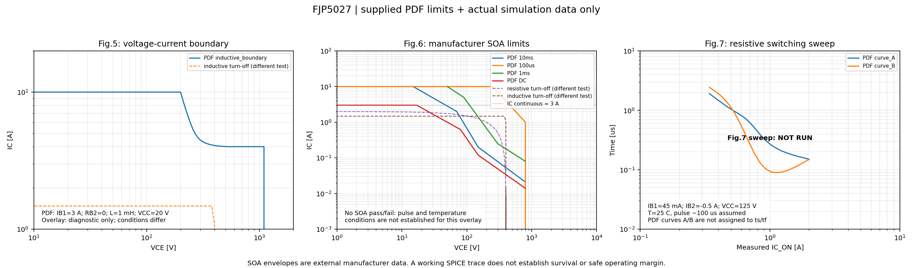

# FJP5027: дополнительные графики 5, 6, 7

**Результат: REFERENCE_AND_BASE_OVERLAY_ONLY.**

Модель: `FJP5027_CANDIDATE_V1`; статус: **STARTING_CANDIDATE_NOT_CALIBRATED**.

Нативный Fig.7: 0 / 0 случаев. Режим: REFERENCE_AND_PREVIOUS_NATIVE_OVERLAY.

## Что означают графики

- Fig.5 имеет оси IC/VCE. По осям и условиям это интерпретируется как граница индуктивного выключения типа RBSOA; название Switching Time не превращает её во временную характеристику.
- Fig.6 — паспортная SOA для DC, 10 ms, 1 ms, 100 us. Кривые взяты из PDF; модель не вычисляет вторичный пробой или разрушение. Наложение траектории носит диагностический характер, автоматического допуска по SOA нет.
- Fig.7 — две типовые зависимости времени от тока. В PDF нет однозначного соответствия линий A/B величинам ts/tf. Поэтому они не переименованы, автоматического совпадения/PASS нет.

## Условия Fig.7

Используется существующий общий QSCH 03. Новая схема не требуется. VBUS=125 V, IB_ON=45 mA, IB_OFF=-0.5 A. Число 45 mA сохранено ровно как в PDF. Меняется R_LOAD=125/Iном; по оси X показан фактический IC_ON.
Допущения: .temp=25 C; 5 kHz; DUTY=0.5; фронт команды 5 ns; два периода. TON=99.995 us. Температура, длительность импульса, фронт и точное определение ts в Fig.7 не указаны.
QPOST сначала измеряет IC_ON, затем по тому же QRAW вычисляет ts от IB=0 до IC=90% фактического IC_ON, tf между 90% и 10%. Второго запуска физической симуляции для нормировки нет.
Высокое VCE_ON (>5 V) отмечено крестиком и в таблице: это проектный диагностический признак. Такая точка не доказывает переключение из насыщения, даже если время математически измерено.
Кривые самого даташита построены из 283 исходных векторных точек. Вертикальные границы и порядок вершин сохранены. Сглаживания и усреднения повторных X нет.

## Траектории из предыдущего прогона

Источник: `20261104T121959.027057Z`; модель `FJP5027_CANDIDATE_V1`. Сохранён отдельный снимок компактных данных с проверкой SHA-256.
- `resistive_Tp25_s2`: VBUS=400 V, R_LOAD=200 ohm, IB_ON=0.4 A, IB_OFF=-0.8 A; шаг 5e-10 s. Условия отличаются от границ PDF.
- `inductive_Tp25_s2`: VCC=20 V, L=2 mH, VCLAMP=400 V, IB_ON=0.3 A, R_B_OFF=1 ohm; шаг 5e-10 s. Условия отличаются от границ PDF.

Точки траекторий взяты из компактного экспорта и не предназначены для оценки субнаносекундных пиков или запаса до SOA. Сходимость исходного индуктивного tf не подтверждена.

## Измерения Fig.7

| Случай | Статус | Iном, A | IC_ON, A | VCE_ON, V | ts, us | tf, us | Режим / ошибка |
|---|---|---:|---:|---:|---:|---:|---|

## Сходимость Fig.7

| Нагрузка | Статус | ΔIC | Δts | Δtf |
|---:|---|---:|---:|---:|

PASS в этой таблице относится только к проверке изменения при уменьшении шага. Совпадение с паспортом, отсутствие разрушения и SOA им не подтверждаются.

QRAW и полный CSV удаляются после обработки по умолчанию; QPOST, CIR, SHA-256 и компактные NPZ остаются. --keep-raw/--keep-waveforms включают сохранение явно.

## Ограничения модели и дальнейшая калибровка

Исходная CANDIDATE_V1 остаётся стартовой оценкой. Это дополнение добавляет независимые цели проверки, но не выполняет подгонку или сертификацию модели. Сначала надо согласовать DC и температурные зависимости; затем динамику. Для проверки fT нужен отдельный AC-стенд.
QSPICE поддерживает MEXTRAM 504 с саморазогревом, но переход требует извлечения дополнительных параметров. Наличие более сложных уравнений не восстанавливает отсутствующие данные; переходная тепловая цепь по этому PDF не определена.

Источники: приложенный Fairchild Rev.A December 2003; [Qorvo о генераторе моделей](https://www.qorvo.com/about/news-events/news-releases/2025/qorvo-adds-modeling-capabilities-to-award-winning-qspice-circuit-simulation-software); [Qorvo о MEXTRAM](https://www.qorvo.com/design-hub/videos/2024-qspice-accelerate-your-development-with-new-features); [Toshiba о SOA](https://toshiba.semicon-storage.com/eu/semiconductor/knowledge/faq/mosfet_bipoler-transistors/technical-documents-for-individual-power-transistors-contain.html).
