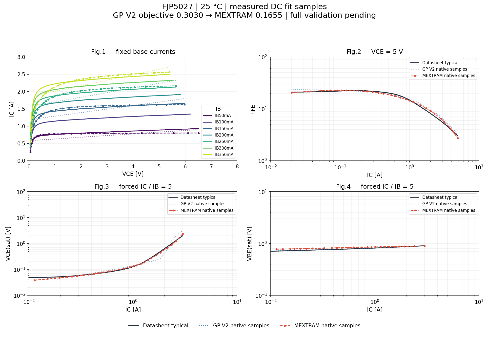

# Реальный MEXTRAM-подбор v6

147 оценок модели за 892.63 s; 142 полностью измерены, 5 отклонены по диапазону hFE. Выполнено 877 QPOST DC-расчётов; следующий, 878-й запуск движка, завершился аварийно на AC-проверке Cobo.

Цель GP V2: 0.302992426; лучший MEXTRAM: 0.165487172; улучшение 45.38%. Лучший результат — оценка 146. Три блока завершены по выделенному бюджету 47 оценок на блок, это не заявление о сходимости оптимизатора.

## P95 только на точках подбора при 25 °C

| Характеристика | GP V2 | MEXTRAM |
|---|---:|---:|
| output / output_Tp25_IB50mA | 17.088% | 13.729% |
| output / output_Tp25_IB150mA | 16.552% | 13.481% |
| output / output_Tp25_IB250mA | 26.211% | 18.082% |
| output / output_Tp25_IB350mA | 29.369% | 18.922% |
| gain / gain_Tp25 | 21.091% | 12.133% |
| vcesat / saturation_Tp25 | 48.516% | 17.057% |
| vbesat / saturation_Tp25 | 1.563% | 8.585% |

VBEsat ухудшилась. Выходные кривые всё ещё превышают проектный допуск 10% на выбранных точках; по остальным семействам полного прогона ещё нет. Эти числа не являются результатами приёмки всех 19 кривых.

На графике данные MEXTRAM и GP — только реальные точки QPOST из архивов; между ними проведены линии для чтения. Полных новых CSV нет, они не восстанавливались искусственно. Исходная GP-цель воспроизведена по прошлому архиву best_native, MEXTRAM — по best_power_native; обе совпали с сохранёнными целями.

## Почему кандидат не установлен

QSPICE64.exe вернул 3221225477 = 0xC0000005 при первом AC-расчёте после подбора. Это код аварийного нарушения доступа к памяти. Нет подтверждения, что причиной является конкретный параметр MEXTRAM или именно AC-линеаризация: сбой мог произойти и при начальном расчёте рабочей точки. В журнале нет пояснения и дампа стека.

В исходном AC CIR одновременно работают Cobo и Cibo, два MEXTRAM, два короткозамкнутых R_K и поведенческие мониторы тока. В продолжении проверяется отдельный транзистор Cobo и прямой ток источника; это диагностическое упрощение, а не доказанно работающий обход.

Тонкая DC-проверка после подбора, Cobo и полная температурная проверка ещё не выполнены. applied=false; GP V2 сохранена. Лучший MEXTRAM находится в checkpoint; повторять 147 оценок не требуется.

[Microsoft: код 0xC0000005](https://learn.microsoft.com/en-us/shows/inside/c0000005)
