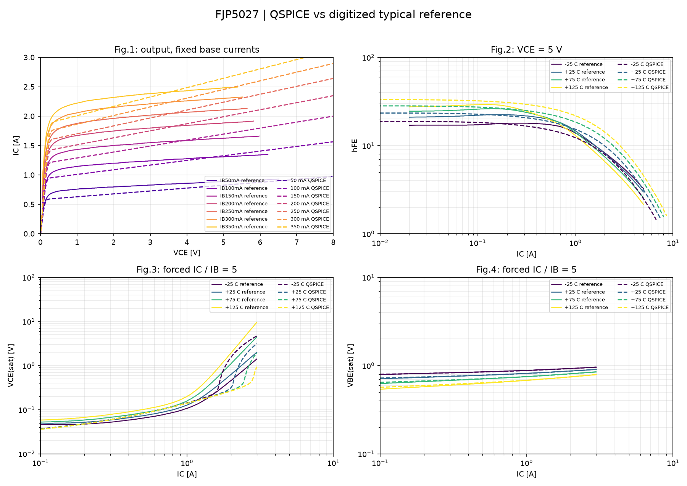
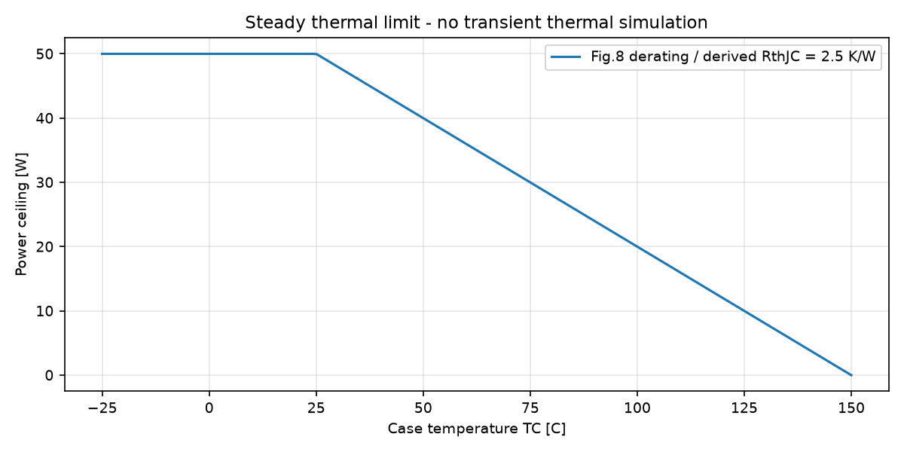

# FJP5027: сравнение модели с даташитом

**Результат: NEEDS_CALIBRATION_OR_RESOLUTION.**

Модель: `FJP5027_DC25_CANDIDATE_V2`; статус: **PARTIAL_NATIVE_DC25_FIT_TEMPERATURE_AND_DYNAMICS_UNVALIDATED**.
Это начальная модель-кандидат. Даже успешное сравнение типовых кривых не доказывает полное соответствие всех экземпляров, SOA и всех режимов.

Рассчитано QSPICE: **16 / 16** случаев. Режим: `QSPICE`.

Сплошные линии: оцифрованный векторный PDF Fairchild Rev.A, December 2003. Пунктир: только реальные результаты QSPICE, если расчёт выполнен.
Кривые не сглаживаются и не подменяются эталоном. На рисунках указаны физические величины и единицы, а не напряжения служебных B-мониторов.
Метрики рассчитаны по полному CSV до очистки. Компактные NPZ служат только для рисунков: сохраняются исходные точки с min/max каждой величины и отдельное окно выключения; новые значения не интерполируются при уплотнении.

## Сравнение типовых кривых

Критерий проекта: P95 относительной ошибки не выше допуска и покрытие не менее 95%. Это пользовательские критерии, не гарантия производителя. При калибровке на этих же кривых результат является качеством подгонки, не независимой проверкой.

| График | Кривая | T, C | Покрытие | RMS | P95 | Max | Допуск P95 | Статус |
|---|---|---:|---:|---:|---:|---:|---:|---|
| output | IB50mA | 25 | 100.000% | 13.067% | 17.228% | 29.681% | 10% | FAIL |
| output | IB100mA | 25 | 100.000% | 9.434% | 11.999% | 31.993% | 10% | FAIL |
| output | IB150mA | 25 | 100.000% | 9.796% | 16.779% | 40.688% | 10% | FAIL |
| output | IB200mA | 25 | 100.000% | 10.267% | 21.307% | 42.434% | 10% | FAIL |
| output | IB250mA | 25 | 100.000% | 11.501% | 26.307% | 48.520% | 10% | FAIL |
| output | IB300mA | 25 | 100.000% | 12.521% | 29.221% | 56.441% | 10% | FAIL |
| output | IB350mA | 25 | 100.000% | 12.337% | 29.613% | 52.534% | 10% | FAIL |
| gain | T-25 | -25 | 100.000% | 11.235% | 19.551% | 23.154% | 15% | FAIL |
| vcesat | T-25 | -25 | 100.000% | 113.441% | 273.704% | 277.792% | 20% | FAIL |
| vbesat | T-25 | -25 | 98.684% | 0.410% | 0.668% | 0.775% | 10% | PASS |
| gain | T+25 | 25 | 100.000% | 10.944% | 21.157% | 22.221% | 15% | FAIL |
| vcesat | T+25 | 25 | 100.000% | 21.859% | 49.659% | 57.326% | 20% | FAIL |
| vbesat | T+25 | 25 | 98.901% | 0.654% | 1.471% | 1.820% | 10% | PASS |
| gain | T+75 | 75 | 100.000% | 36.353% | 63.351% | 64.961% | 15% | FAIL |
| vcesat | T+75 | 75 | 100.000% | 36.164% | 79.699% | 81.531% | 20% | FAIL |
| vbesat | T+75 | 75 | 99.029% | 1.190% | 2.432% | 2.986% | 10% | PASS |
| gain | T+125 | 125 | 100.000% | 73.705% | 123.609% | 124.931% | 15% | FAIL |
| vcesat | T+125 | 125 | 100.000% | 50.728% | 92.132% | 93.488% | 20% | FAIL |
| vbesat | T+125 | 125 | 99.038% | 2.412% | 4.458% | 4.906% | 10% | PASS |

## Табличные точки

| Проверка | Значение SI / указанные единицы | Min | Max | Статус | Основание |
|---|---:|---:|---:|---|---|
| hFE at Ic=0.2 A, Vce=5 V | 21.7518 | 10 | 40 | PASS | guaranteed table limit |
| hFE at Ic=1 A, Vce=5 V | 15.3269 | 8 | - | PASS | guaranteed table limit |
| VCEsat at Ic=1.5 A, Ib=0.3 A [V] | 0.205079 | 0 | 2 | PASS | guaranteed table limit |
| VBEsat at Ic=1.5 A, Ib=0.3 A [V] | 0.84346 | 0 | 1.5 | PASS | guaranteed table limit |
| Cobo [pF], 10 V, 1 MHz | 60.0003 | 48 | 72 | PASS | project +/-20% around 60 pF typical; NOT guaranteed range |

## Сходимость динамики

Сравниваются два самых мелких успешно рассчитанных шага при 25 C. Измерения QPOST выполнены по полному исходному QRAW до очистки временных файлов.

| Стенд | Метрика | Шаг грубее, с | Шаг мельче, с | Значение грубее | Значение мельче | Изменение | Статус |
|---|---|---:|---:|---:|---:|---:|---|

## Температура и тепловые пределы

Прогоны .temp являются изотермическими: температура модели задаётся явно. На типовых кривых обозначено TC; равенство Tj=TC является допущением сравнения без саморазогрева.
Из Fig.8 выведено RthJC=(150-25)/50=2.5 K/W. Это стационарная оценка, не идентифицированная тепловая RC-цепь. В PDF нет Zth(t), поэтому Cth и переходный нагрев не выдуманы.

Для посчитанной периодической мощности можно оценить Tj при фиксированной TC; эта оценка не замыкает электротепловую обратную связь:

| Случай | Pcollector+Pbase, Вт | TC, C | Оценка Tj, C |
|---|---:|---:|---:|

## Область применимости

- Рис.1: 7 значений IB, 25 C принято по условиям по умолчанию; температура внутри рисунка не подписана.
- Рис.2: VCE=5 V; hFE строится по фактическому IC и IC/IB, не по V_SCAN.
- Рис.3 и 4: принудительный IC/IB=5. Заголовки рисунков в PDF неоднозначны; используются подписи осей.
- Табличное резистивное переключение: 400 V, 200 ohm, IB1=0.4 A, IB2=-0.8 A. Частота, фронт и отсчёт времени явно сохранены в случаях; определения времени нужно сверять при точной паспортной приёмке.
- CIL является диагностикой коммутации при заданном ограничении, не доказательством VCEX(sus), лавины или RBSOA.
- Fig.5 имеет оси IC/VCE и является границей переключаемого режима, несмотря на название Switching Time. Его нельзя сравнивать с временной осциллограммой.
- Fig.7 содержит две временные кривые без однозначной подписи каждой: автоматическое присвоение ts/tf и PASS не выполняются.
- fT, пробой, утечки при 800 V, вторичный пробой, ресурс и transient Zth не проверены этим набором.
- Энергия E_OFF_WINDOW: знаковый интеграл коллекторного порта за окно, не энергия всего дросселя и не автоматически истинное тепло кристалла.

## Случаи и диагностика

| Случай | Статус | Источник | Ошибка / замечание |
|---|---|---|---|
| output_Tp25_IB50mA | SIMULATED | QUX netlist of user QSCH | Only X_OUT branch retained; other independent DUT branches and unused hFE monitor omitted |
| output_Tp25_IB100mA | SIMULATED | QUX netlist of user QSCH | Only X_OUT branch retained; other independent DUT branches and unused hFE monitor omitted |
| output_Tp25_IB150mA | SIMULATED | QUX netlist of user QSCH | Only X_OUT branch retained; other independent DUT branches and unused hFE monitor omitted |
| output_Tp25_IB200mA | SIMULATED | QUX netlist of user QSCH | Only X_OUT branch retained; other independent DUT branches and unused hFE monitor omitted |
| output_Tp25_IB250mA | SIMULATED | QUX netlist of user QSCH | Only X_OUT branch retained; other independent DUT branches and unused hFE monitor omitted |
| output_Tp25_IB300mA | SIMULATED | QUX netlist of user QSCH | Only X_OUT branch retained; other independent DUT branches and unused hFE monitor omitted |
| output_Tp25_IB350mA | SIMULATED | QUX netlist of user QSCH | Only X_OUT branch retained; other independent DUT branches and unused hFE monitor omitted |
| gain_Tm25 | SIMULATED | QUX netlist of user QSCH | Only X_GUMMEL branch retained; other independent DUT branches and unused hFE monitor omitted |
| saturation_Tm25 | SIMULATED | QUX netlist of user QSCH |  |
| gain_Tp25 | SIMULATED | QUX netlist of user QSCH | Only X_GUMMEL branch retained; other independent DUT branches and unused hFE monitor omitted |
| saturation_Tp25 | SIMULATED | QUX netlist of user QSCH |  |
| gain_Tp75 | SIMULATED | QUX netlist of user QSCH | Only X_GUMMEL branch retained; other independent DUT branches and unused hFE monitor omitted |
| saturation_Tp75 | SIMULATED | QUX netlist of user QSCH |  |
| gain_Tp125 | SIMULATED | QUX netlist of user QSCH | Only X_GUMMEL branch retained; other independent DUT branches and unused hFE monitor omitted |
| saturation_Tp125 | SIMULATED | QUX netlist of user QSCH |  |
| cap_Tp25 | SIMULATED | QUX netlist of user QSCH |  |

## Все измерения QPOST

| Случай | Метрика | Значение SI |
|---|---|---:|
| output_Tp25_IB50mA | OUTPUT_ID_MAX | 0.974738 |
| output_Tp25_IB100mA | OUTPUT_ID_MAX | 1.56563 |
| output_Tp25_IB150mA | OUTPUT_ID_MAX | 2.00055 |
| output_Tp25_IB200mA | OUTPUT_ID_MAX | 2.34901 |
| output_Tp25_IB250mA | OUTPUT_ID_MAX | 2.64204 |
| output_Tp25_IB300mA | OUTPUT_ID_MAX | 2.89625 |
| output_Tp25_IB350mA | OUTPUT_ID_MAX | 3.12167 |
| gain_Tm25 | HFE_0P2 | 17.5121 |
| gain_Tm25 | HFE_1 | 12.3042 |
| saturation_Tm25 | VCESAT_1P5 | 0.224478 |
| saturation_Tm25 | VBESAT_1P5 | 0.904904 |
| saturation_Tm25 | IB_AT_1P5 | 0.3 |
| gain_Tp25 | HFE_0P2 | 21.7518 |
| gain_Tp25 | HFE_1 | 15.3269 |
| saturation_Tp25 | VCESAT_1P5 | 0.205079 |
| saturation_Tp25 | VBESAT_1P5 | 0.84346 |
| saturation_Tp25 | IB_AT_1P5 | 0.3 |
| gain_Tp75 | HFE_0P2 | 26.1889 |
| gain_Tp75 | HFE_1 | 18.5078 |
| saturation_Tp75 | VCESAT_1P5 | 0.201275 |
| saturation_Tp75 | VBESAT_1P5 | 0.780271 |
| saturation_Tp75 | IB_AT_1P5 | 0.3 |
| gain_Tp125 | HFE_0P2 | 30.8209 |
| gain_Tp125 | HFE_1 | 21.8467 |
| saturation_Tp125 | VCESAT_1P5 | 0.200196 |
| saturation_Tp125 | VBESAT_1P5 | 0.715623 |
| saturation_Tp125 | IB_AT_1P5 | 0.3 |
| cap_Tp25 | COBO_I_IM | 0.000376993 |
| cap_Tp25 | CIBO_I_IM | 0.00950116 |

## Воспроизводимость

UTC: 2026-11-04T14:54:42.282492+00:00. Python: 3.14.0.

Исходные QSCH не изменяются. На каждый случай создаётся отдельный CIR без .step; модель и адаптер заморожены в CIR. Сохранены параметры, хеши, журналы, QPOST, метрики и компактные данные рисунков. В версии 2 QRAW и полный waveforms.csv удаляются после обработки каждого случая по умолчанию; --keep-raw и --keep-waveforms включают их сохранение.
Освобождено этим запуском: 20.310 MiB. Старые рисунки и метрики версии 1 сохраняются при пересборке, даже если пользователь уже удалил CSV/QRAW; утраченные исходные точки не восстанавливаются.

| Файл | SHA-256 |
|---|---|
| D:\2.github\QSPICElib\transistors\BJT\FJP5027\profile.json | `f09341e84d4e3a3d24803c7bd74211bf1e0e7356fd8ddc97e84cb1ae6fe3f9bc` |
| D:\2.github\QSPICElib\transistors\BJT\FJP5027\FJP5027.txt | `37b96a1d3c2640ffe2334674d3de69113da89ed626bbafa1ae03bbd415ac8545` |
| D:\2.github\QSPICElib\transistors\BJT\FJP5027\reference\curves.csv | `d82acbd8fe697bafefa3b4e4ebd561f95f432b536e0067b806c9fdda3b18c813` |
| D:\2.github\QSPICElib\transistors\BJT\FJP5027\reference\FJP5027_RevA_2003.pdf | `b1488f766fcb8f25a83d24dadc9658cd8edda4b450ebdcac5c35435996df8ba3` |
| D:\2.github\QSPICElib\transistors\_common\bjt_suite.py | `bb609dc9fcf571e2bde951a1bcbb93932772525693b7de63373f7eda696dc9c2` |
| D:\2.github\QSPICElib\transistors\_common\qspice_io.py | `a2c57ccb5698e0fe6d48900db609c981459a01a5e102e38e3e37ed2dff3244b8` |
| D:\2.github\QSPICElib\transistors\Si\transistor_common_cir_v1\bjt\01_output_gummel_leakage_dc.qsch | `2ff8228369314ea763b021ac503bfea6d1a5cb365e8bfc8e855e8a4458da47de` |
| D:\2.github\QSPICElib\transistors\Si\transistor_common_cir_v1\bjt\05_forced_beta_saturation_dc.qsch | `e37fbc502bf4d064aca7749202f0f90ed3275ea3d025de33e07911bef72274af` |
| D:\2.github\QSPICElib\transistors\Si\transistor_common_cir_v1\bjt\02_junction_capacitance_ac.qsch | `d5b5266e664256d636b5add8c4b565fa0cd31af8842b9ee0ea562cea485382e5` |
