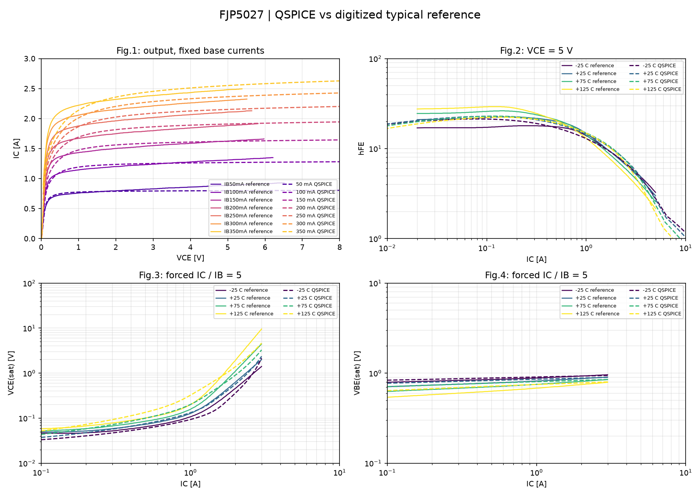

# Разбор нативного продолжения v7

15/15 DC-случаев рассчитаны. Полные кривые: 5 PASS, 14 FAIL, 0 INVALID. Все четыре табличные точки при 25 °C PASS. Цель на тонкой DC-сетке 0.165343 против сохранённой 0.165487: отличие около 0.087%.

## Полные температурные кривые, P95 относительной ошибки

| T, °C | hFE | VCEsat | VBEsat |
|---:|---:|---:|---:|
| -25 | 22.904% (FAIL) | 27.443% (FAIL) | 5.047% (PASS) |
| 25 | 12.323% (PASS) | 14.772% (PASS) | 8.505% (PASS) |
| 75 | 24.398% (FAIL) | 27.922% (FAIL) | 12.208% (FAIL) |
| 125 | 33.427% (FAIL) | 60.742% (FAIL) | 17.835% (FAIL) |

Проектные допуски: hFE 15%, VCEsat 20%, VBEsat 10%; покрытие ≥95%. Выходная IB=100mA прошла, остальные шесть пока FAIL с P95 13.2–20.3%.

К ранее проходящим GP-кривым возникли две регрессии: VBEsat при +75 °C и +125 °C. Поэтому автоматическая установка MEXTRAM заблокирована независимо от состояния AC.

## AC

GP-контроль дал 60.0003 pF в обоих движках. MEXTRAM в отдельном одноместном Cobo-CIR завершился с 0xC0000005 в QSPICE64 и QSPICE80. Второй транзистор и B-мониторы не требуются для воспроизведения этого сбоя. Причина внутри процесса не установлена.

## Сохранность данных

Проверены SHA-256 и конечность всех 15 компактных NPZ. Оценки P95 сохранены по полному CSV до его очистки. Освобождено около 19.81 MiB. Исходные GP и профиль не заменены.

Следующий пакет добавляет многотемпературный подбор 498 точек и диагностические варианты выводов/анализов. Их нативных результатов ещё нет.
