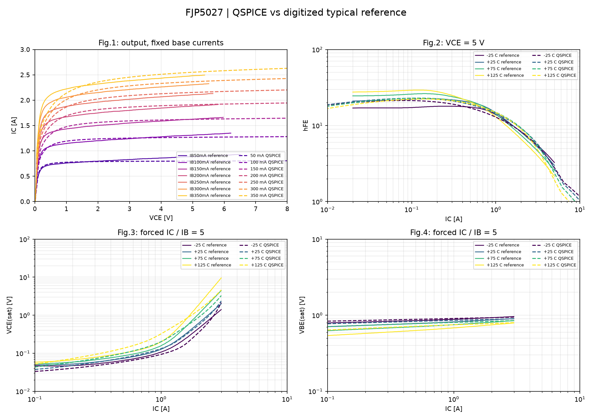

# FJP5027: продолжение сохранённого MEXTRAM-подбора

**MEXTRAM_HELD_PREVIOUS_MODEL_RETAINED**

147 прошлых оценок не повторяются. Выполняются новая GP-база, тонкая DC-проверка сохранённого кандидата, отдельная Cobo и 15 температурных DC-случаев в изолированной папке.
Cobo: один транзистор, VCB=10 V, эмиттер через 1 TΩ, 1 MHz; ток берётся непосредственно из источника. Перед MEXTRAM выполняется GP-контроль. При ошибке 64 проверяется движок 80, каждый результат подписан.

Установка: **False**. Cobo принята: **False**.
Если Cobo не рассчиталась, температурные DC-кривые всё равно собираются для диагностики; установка блокируется. Отсутствующее измерение не объявляется PASS.

| Проверка | Значение |
|---|---:|
| saved_cost | 0.1654871724218501 |
| baseline_cost | 0.30299242569271884 |
| fine_cost | 0.1653430780408372 |
| fine_dc_pass | True |
| all_dc_cases_simulated | True |
| dc_table_limits_pass | True |

Движок 64: **FAILED**; GP Cobo=60.0002994610429 pF; MEXTRAM Cobo=— pF.
Ошибка: `SuiteError: QSPICE64.exe: exit 3221225477; see D:\2.github\QSPICElib\transistors\BJT\FJP5027\power_resume_results\20261104T172700.170877Z\cap_checks\engine64\mex_0\simulator.stderr.log`.

Движок 80: **FAILED**; GP Cobo=60.0002994610429 pF; MEXTRAM Cobo=— pF.
Ошибка: `SuiteError: QSPICE80.exe: exit 3221225477; see D:\2.github\QSPICElib\transistors\BJT\FJP5027\power_resume_results\20261104T172700.170877Z\cap_checks\engine80\mex_0\simulator.stderr.log`.

Полные кривые: PASS=5, FAIL=14, INVALID=0. Эти результаты относятся ко всем точкам полного прогона, а не только к подбору.

[Полный DC-отчёт](validation/report.md)

Потеря прежних PASS: `[['vbesat', 'T+75', 75], ['vbesat', 'T+125', 125]]`.

Температура проверяется изотермически; динамика, заряды и SOA этим продолжением не принимаются. Первичная причина аварии исходного AC-стенда пока не установлена.
