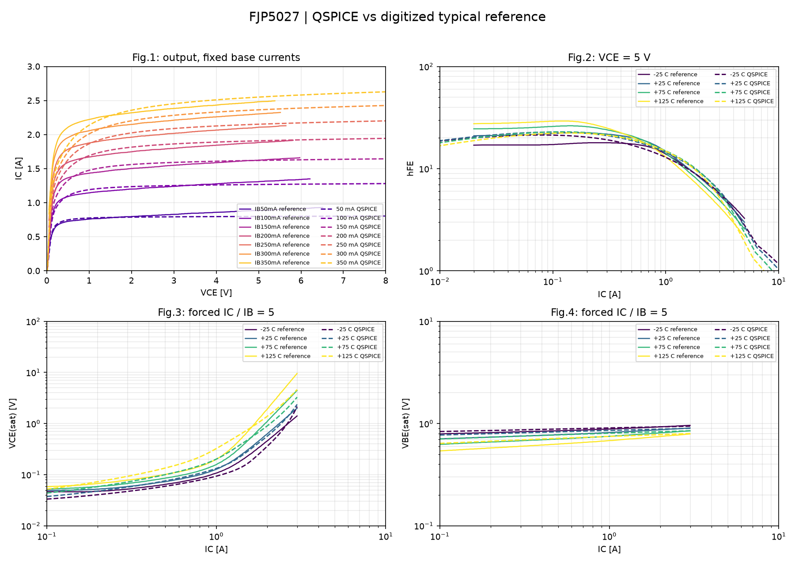
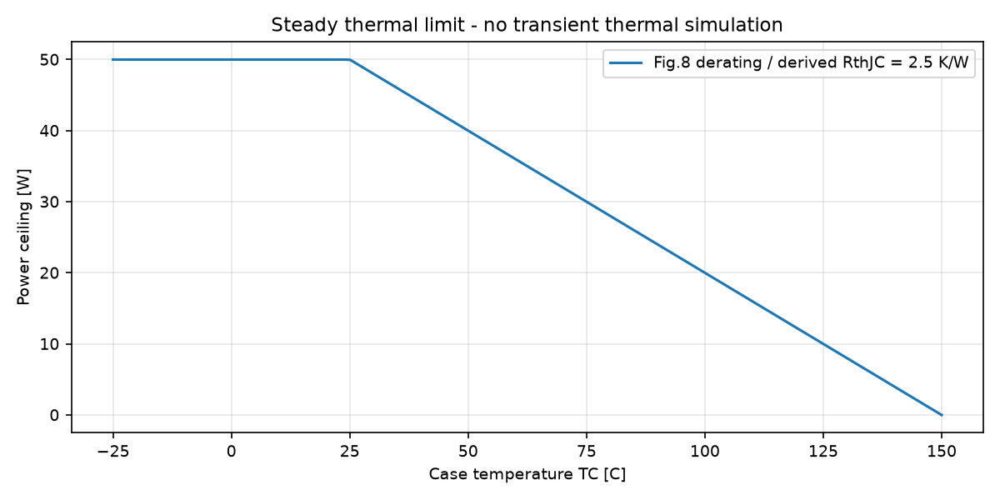

# FJP5027: сравнение модели с даташитом

**Результат: NEEDS_CALIBRATION_OR_RESOLUTION.**

Модель: `FJP5027_MEXTRAM_DC25_CANDIDATE_V3`; статус: **MEXTRAM_CANDIDATE_VALIDATION_ONLY**.
Это начальная модель-кандидат. Даже успешное сравнение типовых кривых не доказывает полное соответствие всех экземпляров, SOA и всех режимов.

Рассчитано QSPICE: **15 / 15** случаев. Режим: `QSPICE`.

Сплошные линии: оцифрованный векторный PDF Fairchild Rev.A, December 2003. Пунктир: только реальные результаты QSPICE, если расчёт выполнен.
Кривые не сглаживаются и не подменяются эталоном. На рисунках указаны физические величины и единицы, а не напряжения служебных B-мониторов.
Метрики рассчитаны по полному CSV до очистки. Компактные NPZ служат только для рисунков: сохраняются исходные точки с min/max каждой величины и отдельное окно выключения; новые значения не интерполируются при уплотнении.

## Сравнение типовых кривых

Критерий проекта: P95 относительной ошибки не выше допуска и покрытие не менее 95%. Это пользовательские критерии, не гарантия производителя. При калибровке на этих же кривых результат является качеством подгонки, не независимой проверкой.

| График | Кривая | T, C | Покрытие | RMS | P95 | Max | Допуск P95 | Статус |
|---|---|---:|---:|---:|---:|---:|---:|---|
| output | IB50mA | 25 | 100.000% | 6.906% | 13.196% | 28.142% | 10% | FAIL |
| output | IB100mA | 25 | 100.000% | 5.241% | 8.604% | 28.224% | 10% | PASS |
| output | IB150mA | 25 | 100.000% | 6.886% | 13.549% | 33.735% | 10% | FAIL |
| output | IB200mA | 25 | 100.000% | 7.848% | 15.957% | 31.837% | 10% | FAIL |
| output | IB250mA | 25 | 100.000% | 8.965% | 17.867% | 35.605% | 10% | FAIL |
| output | IB300mA | 25 | 100.000% | 10.282% | 20.255% | 42.677% | 10% | FAIL |
| output | IB350mA | 25 | 100.000% | 9.682% | 18.863% | 34.548% | 10% | FAIL |
| gain | T-25 | -25 | 100.000% | 10.948% | 22.904% | 25.091% | 15% | FAIL |
| vcesat | T-25 | -25 | 100.000% | 16.318% | 27.443% | 52.115% | 20% | FAIL |
| vbesat | T-25 | -25 | 98.684% | 3.338% | 5.047% | 5.386% | 10% | PASS |
| gain | T+25 | 25 | 100.000% | 6.233% | 12.323% | 13.348% | 15% | PASS |
| vcesat | T+25 | 25 | 100.000% | 7.518% | 14.772% | 24.878% | 20% | PASS |
| vbesat | T+25 | 25 | 98.901% | 6.074% | 8.505% | 8.851% | 10% | PASS |
| gain | T+75 | 75 | 100.000% | 13.200% | 24.398% | 25.370% | 15% | FAIL |
| vcesat | T+75 | 75 | 100.000% | 18.239% | 27.922% | 29.168% | 20% | FAIL |
| vbesat | T+75 | 75 | 99.029% | 9.185% | 12.208% | 12.764% | 10% | FAIL |
| gain | T+125 | 125 | 100.000% | 20.464% | 33.427% | 35.043% | 15% | FAIL |
| vcesat | T+125 | 125 | 100.000% | 34.741% | 60.742% | 62.539% | 20% | FAIL |
| vbesat | T+125 | 125 | 99.038% | 13.458% | 17.835% | 18.280% | 10% | FAIL |

## Табличные точки

| Проверка | Значение SI / указанные единицы | Min | Max | Статус | Основание |
|---|---:|---:|---:|---|---|
| hFE at Ic=0.2 A, Vce=5 V | 22.1904 | 10 | 40 | PASS | guaranteed table limit |
| hFE at Ic=1 A, Vce=5 V | 14.4181 | 8 | - | PASS | guaranteed table limit |
| VCEsat at Ic=1.5 A, Ib=0.3 A [V] | 0.271374 | 0 | 2 | PASS | guaranteed table limit |
| VBEsat at Ic=1.5 A, Ib=0.3 A [V] | 0.87119 | 0 | 1.5 | PASS | guaranteed table limit |

## Сходимость динамики

Сравниваются два самых мелких успешно рассчитанных шага при 25 C. Измерения QPOST выполнены по полному исходному QRAW до очистки временных файлов.

| Стенд | Метрика | Шаг грубее, с | Шаг мельче, с | Значение грубее | Значение мельче | Изменение | Статус |
|---|---|---:|---:|---:|---:|---:|---|

## Температура и тепловые пределы

Прогоны .temp являются изотермическими: температура модели задаётся явно. На типовых кривых обозначено TC; равенство Tj=TC является допущением сравнения без саморазогрева.
Из Fig.8 выведено RthJC=(150-25)/50=2.5 K/W. Это стационарная оценка, не идентифицированная тепловая RC-цепь. В PDF нет Zth(t), поэтому Cth и переходный нагрев не выдуманы.

Для посчитанной периодической мощности можно оценить Tj при фиксированной TC; эта оценка не замыкает электротепловую обратную связь:

| Случай | Pcollector+Pbase, Вт | TC, C | Оценка Tj, C |
|---|---:|---:|---:|

## Область применимости

- Рис.1: 7 значений IB, 25 C принято по условиям по умолчанию; температура внутри рисунка не подписана.
- Рис.2: VCE=5 V; hFE строится по фактическому IC и IC/IB, не по V_SCAN.
- Рис.3 и 4: принудительный IC/IB=5. Заголовки рисунков в PDF неоднозначны; используются подписи осей.
- Табличное резистивное переключение: 400 V, 200 ohm, IB1=0.4 A, IB2=-0.8 A. Частота, фронт и отсчёт времени явно сохранены в случаях; определения времени нужно сверять при точной паспортной приёмке.
- CIL является диагностикой коммутации при заданном ограничении, не доказательством VCEX(sus), лавины или RBSOA.
- Fig.5 имеет оси IC/VCE и является границей переключаемого режима, несмотря на название Switching Time. Его нельзя сравнивать с временной осциллограммой.
- Fig.7 содержит две временные кривые без однозначной подписи каждой: автоматическое присвоение ts/tf и PASS не выполняются.
- fT, пробой, утечки при 800 V, вторичный пробой, ресурс и transient Zth не проверены этим набором.
- Энергия E_OFF_WINDOW: знаковый интеграл коллекторного порта за окно, не энергия всего дросселя и не автоматически истинное тепло кристалла.

## Случаи и диагностика

| Случай | Статус | Источник | Ошибка / замечание |
|---|---|---|---|
| output_Tp25_IB50mA | SIMULATED | QUX netlist of user QSCH | Only X_OUT branch retained; other independent DUT branches and unused hFE monitor omitted |
| output_Tp25_IB100mA | SIMULATED | QUX netlist of user QSCH | Only X_OUT branch retained; other independent DUT branches and unused hFE monitor omitted |
| output_Tp25_IB150mA | SIMULATED | QUX netlist of user QSCH | Only X_OUT branch retained; other independent DUT branches and unused hFE monitor omitted |
| output_Tp25_IB200mA | SIMULATED | QUX netlist of user QSCH | Only X_OUT branch retained; other independent DUT branches and unused hFE monitor omitted |
| output_Tp25_IB250mA | SIMULATED | QUX netlist of user QSCH | Only X_OUT branch retained; other independent DUT branches and unused hFE monitor omitted |
| output_Tp25_IB300mA | SIMULATED | QUX netlist of user QSCH | Only X_OUT branch retained; other independent DUT branches and unused hFE monitor omitted |
| output_Tp25_IB350mA | SIMULATED | QUX netlist of user QSCH | Only X_OUT branch retained; other independent DUT branches and unused hFE monitor omitted |
| gain_Tm25 | SIMULATED | QUX netlist of user QSCH | Only X_GUMMEL branch retained; other independent DUT branches and unused hFE monitor omitted |
| saturation_Tm25 | SIMULATED | QUX netlist of user QSCH |  |
| gain_Tp25 | SIMULATED | QUX netlist of user QSCH | Only X_GUMMEL branch retained; other independent DUT branches and unused hFE monitor omitted |
| saturation_Tp25 | SIMULATED | QUX netlist of user QSCH |  |
| gain_Tp75 | SIMULATED | QUX netlist of user QSCH | Only X_GUMMEL branch retained; other independent DUT branches and unused hFE monitor omitted |
| saturation_Tp75 | SIMULATED | QUX netlist of user QSCH |  |
| gain_Tp125 | SIMULATED | QUX netlist of user QSCH | Only X_GUMMEL branch retained; other independent DUT branches and unused hFE monitor omitted |
| saturation_Tp125 | SIMULATED | QUX netlist of user QSCH |  |

## Все измерения QPOST

| Случай | Метрика | Значение SI |
|---|---|---:|
| output_Tp25_IB50mA | OUTPUT_ID_MAX | 0.804875 |
| output_Tp25_IB100mA | OUTPUT_ID_MAX | 1.28109 |
| output_Tp25_IB150mA | OUTPUT_ID_MAX | 1.64482 |
| output_Tp25_IB200mA | OUTPUT_ID_MAX | 1.94481 |
| output_Tp25_IB250mA | OUTPUT_ID_MAX | 2.20184 |
| output_Tp25_IB300mA | OUTPUT_ID_MAX | 2.4273 |
| output_Tp25_IB350mA | OUTPUT_ID_MAX | 2.62837 |
| gain_Tm25 | HFE_0P2 | 20.3759 |
| gain_Tm25 | HFE_1 | 12.9019 |
| saturation_Tm25 | VCESAT_1P5 | 0.157942 |
| saturation_Tm25 | VBESAT_1P5 | 0.919691 |
| saturation_Tm25 | IB_AT_1P5 | 0.3 |
| gain_Tp25 | HFE_0P2 | 22.1904 |
| gain_Tp25 | HFE_1 | 14.4181 |
| saturation_Tp25 | VCESAT_1P5 | 0.271374 |
| saturation_Tp25 | VBESAT_1P5 | 0.87119 |
| saturation_Tp25 | IB_AT_1P5 | 0.3 |
| gain_Tp75 | HFE_0P2 | 22.5465 |
| gain_Tp75 | HFE_1 | 14.9366 |
| saturation_Tp75 | VCESAT_1P5 | 0.457618 |
| saturation_Tp75 | VBESAT_1P5 | 0.819515 |
| saturation_Tp75 | IB_AT_1P5 | 0.3 |
| gain_Tp125 | HFE_0P2 | 22.1037 |
| gain_Tp125 | HFE_1 | 14.8203 |
| saturation_Tp125 | VCESAT_1P5 | 0.72456 |
| saturation_Tp125 | VBESAT_1P5 | 0.765218 |
| saturation_Tp125 | IB_AT_1P5 | 0.3 |

## Воспроизводимость

UTC: 2026-11-04T17:27:13.140959+00:00. Python: 3.14.0.

Исходные QSCH не изменяются. На каждый случай создаётся отдельный CIR без .step; модель и адаптер заморожены в CIR. Сохранены параметры, хеши, журналы, QPOST, метрики и компактные данные рисунков. В версии 2 QRAW и полный waveforms.csv удаляются после обработки каждого случая по умолчанию; --keep-raw и --keep-waveforms включают их сохранение.
Освобождено этим запуском: 19.811 MiB. Старые рисунки и метрики версии 1 сохраняются при пересборке, даже если пользователь уже удалил CSV/QRAW; утраченные исходные точки не восстанавливаются.

| Файл | SHA-256 |
|---|---|
| D:\2.github\QSPICElib\transistors\BJT\FJP5027\power_resume_results\20261104T172700.170877Z\candidate_workspace\profile.json | `b2d5bd70dc3e20da38a6f4dc6c49e3b637545d775e234cf19c2c08923e06ef0a` |
| D:\2.github\QSPICElib\transistors\BJT\FJP5027\power_resume_results\20261104T172700.170877Z\candidate_workspace\FJP5027.txt | `96e3bee5f466a32149bbddc601fa4903299365c1fdb08a35ba0e5de2304f6768` |
| D:\2.github\QSPICElib\transistors\BJT\FJP5027\power_resume_results\20261104T172700.170877Z\candidate_workspace\reference\curves.csv | `d82acbd8fe697bafefa3b4e4ebd561f95f432b536e0067b806c9fdda3b18c813` |
| D:\2.github\QSPICElib\transistors\BJT\FJP5027\power_resume_results\20261104T172700.170877Z\candidate_workspace\reference\FJP5027_RevA_2003.pdf | `b1488f766fcb8f25a83d24dadc9658cd8edda4b450ebdcac5c35435996df8ba3` |
| D:\2.github\QSPICElib\transistors\_common\bjt_suite.py | `bb609dc9fcf571e2bde951a1bcbb93932772525693b7de63373f7eda696dc9c2` |
| D:\2.github\QSPICElib\transistors\_common\qspice_io.py | `a2c57ccb5698e0fe6d48900db609c981459a01a5e102e38e3e37ed2dff3244b8` |
| D:\2.github\QSPICElib\transistors\Si\transistor_common_cir_v1\bjt\01_output_gummel_leakage_dc.qsch | `2ff8228369314ea763b021ac503bfea6d1a5cb365e8bfc8e855e8a4458da47de` |
| D:\2.github\QSPICElib\transistors\Si\transistor_common_cir_v1\bjt\05_forced_beta_saturation_dc.qsch | `e37fbc502bf4d064aca7749202f0f90ed3275ea3d025de33e07911bef72274af` |
