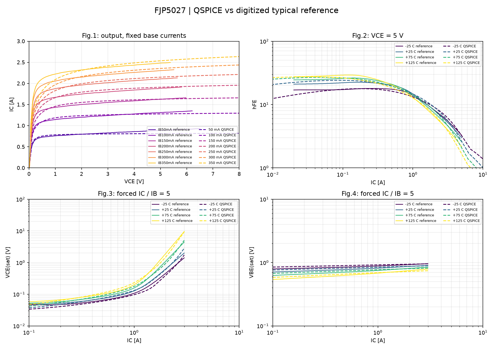

# Реальный результат многотемпературного подбора v8

Выполнены все 150 оценок, 2250/2250 нативных DC-запусков и QPOST. Тонкая оценка 150 завершилась примерно через 2001.77 s от старта (около 33.36 min, без последующих графиков). Все 15 финальных статических случаев рассчитаны.

**10 PASS, 9 FAIL, 0 INVALID**, ранее 5 PASS / 14 FAIL. Потерь защищённых PASS нет. Все четыре табличные точки при 25 C PASS. GP V2 остаётся установленной; новый MEXTRAM сохранён отдельно.

Общая многотемпературная цель со штрафами снизилась 1.748185 → 0.193092. Это не процент физической ошибки и не сопоставимо с отдельной старой DC25-целью.

| T, °C | hFE P95 | VCEsat P95 | VBEsat P95 |
|---:|---:|---:|---:|
| -25 | 12.830% (PASS) | 21.939% (FAIL) | 6.705% (PASS) |
| 25 | 12.179% (PASS) | 17.205% (PASS) | 7.207% (PASS) |
| 75 | 11.723% (PASS) | 14.124% (PASS) | 7.031% (PASS) |
| 125 | 16.216% (FAIL) | 20.508% (FAIL) | 7.421% (PASS) |

Среди выходных кривых прошла IB=100mA. Остальные шесть имеют P95 11.66–20.64% при проектном допуске 10%.

## Диагностика AC/TRAN

MEXTRAM OP, DC и TRAN завершились. Его AC с тремя/четырьмя выводами падает с 0xC0000005 в обоих движках. Это локализует проблему в AC-расчёте данной конфигурации, но не устанавливает точную причину внутри процесса.
Контроль GP: AC 60.000299 pF, TRAN 60.001414 pF, разница около 0.00186%. MEXTRAM TRAN дал предварительную оценку 89.686039 pF. Диагностика выполнялась до нового температурного подбора; это число относится к входному, прежнему кандидату. Шаг/амплитуда/окно ещё не проверялись, принятия Cobo нет.

Запись Q_TEST c 0 e 0 dt MODEL оказалась неверной для использованного парсера: моделью было принято имя 0, DT и настоящее имя модели проигнорированы. Три пятиузловых попытки были отклонены проверкой журнала и не участвовали в подборе. Их нельзя считать проверкой тепловой функциональности. В v9 этот синтаксис исключён из генератора.

Следующая стадия начинает с этой реальной оценки 150, использует все доступные точки и проверяет малосигнальную TRAN-ёмкость. Новых нативных результатов v9 ещё нет.
