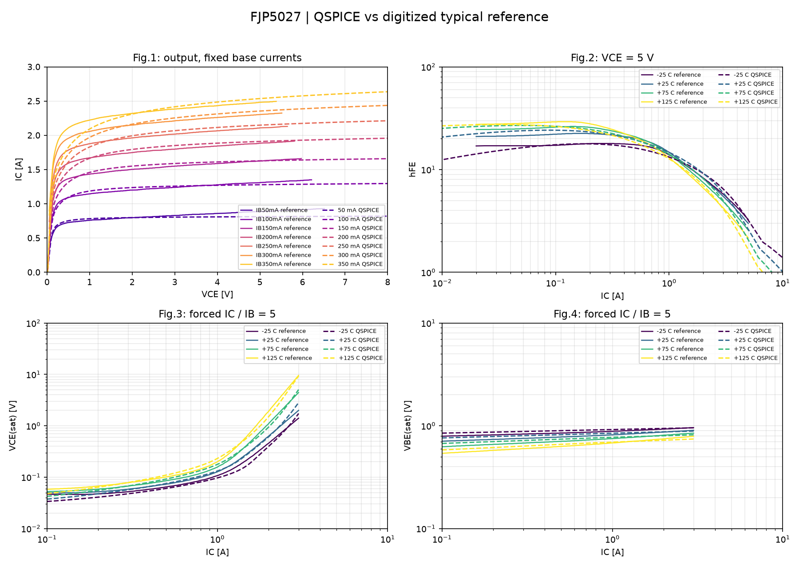

# FJP5027: многотемпературная калибровка

**MULTITEMPERATURE_RESEARCH_CANDIDATE_SAVED**

Подбор: 7 выходных кривых при 25 C и hFE/VCEsat/VBEsat при -25, 25, 75, 125 C. Все значения цели получены QSPICE/QPOST; четыре семейства имеют одинаковый суммарный вес квадрата логарифмической ошибки.
Дополнительные штрафы защищают объединение ранее проходящих кривых GP и MEXTRAM. Штраф использует точки подбора и не заменяет проверку полного CSV. Допуски и эталонные точки не меняются.

Оценок: 150 / 150. Установленная GP не изменяется этой стадией.

[Диагностика AC и структуры выводов](ac_diagnostics/report.md)

| Стадия | Норма общей цели |
|---|---:|
| starting | 1.7481848184046638 |
| explicit_defaults | 1.7481848184046638 |
| temperature_seed | 13.702963035993863 |
| best_fine | 0.19309204643169883 |

Полные кривые: {'PASS': 10, 'FAIL': 9, 'INVALID': 0}. Потери прежних PASS: [].

[Полный статический отчёт](validation/report.md)

Cobo, fT, заряд и переключение этим DC-подбором не приняты. RTH=0, саморазогрева нет. Новый кандидат сохраняется отдельно; до решения AC-сбоя автоматической установки нет.

[Параметры и температурные зависимости MEXTRAM, §4.7](https://www.eng.auburn.edu/~niuguof/mextram/_downloads/f100656dc339d74fab1450e1cb6180ed/Mextramdefinition_504.10.1.pdf)
