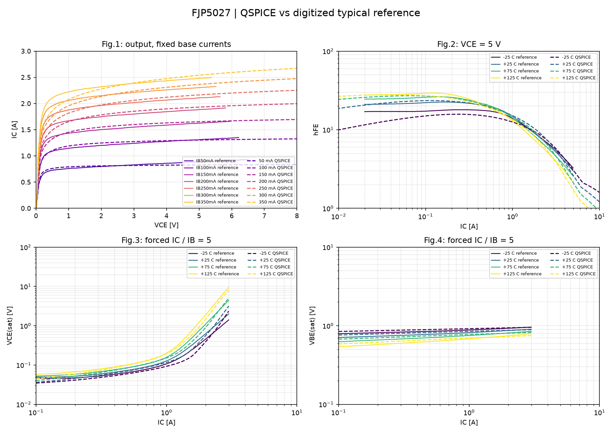

# FJP5027: многотемпературная калибровка

**MULTITEMPERATURE_CANDIDATE_HAS_PROTECTED_REGRESSIONS**

Подбор: 7 выходных кривых при 25 C и hFE/VCEsat/VBEsat при -25, 25, 75, 125 C. Все значения цели получены QSPICE/QPOST; четыре семейства имеют одинаковый суммарный вес квадрата логарифмической ошибки.
Дополнительные штрафы защищают объединение ранее проходящих кривых GP и MEXTRAM. Штраф использует точки подбора и не заменяет проверку полного CSV. Допуски и эталонные точки не меняются.

Оценок: 150 / 180. Установленная GP не изменяется этой стадией.

[Диагностика ёмкости через TRAN](transient_cap/report.md)

| Стадия | Норма общей цели |
|---|---:|
| starting | 4.044593968693925 |
| best_fine | 2.128707687307809 |

Полные кривые: {'PASS': 11, 'FAIL': 8, 'INVALID': 0}. Потери прежних PASS: [{'kind': 'gain', 'curve': 'T-25', 'temperature_C': -25, 'tolerance': 0.15}, {'kind': 'vcesat', 'curve': 'T+25', 'temperature_C': 25, 'tolerance': 0.2}].

[Полный статический отчёт](validation/report.md)

Уточнение использует все доступные эталонные точки в пределах стендов и штрафы для всех 19 кривых. Запас в цели составляет 10% от прежнего допуска; приёмочные допуски не изменены.

Ёмкость через TRAN: **TRAN_COBO_CALIBRATED_AND_CONVERGED**. Нативный AC этим не исправлен и не объявляется PASS.

Cobo, fT, заряд и переключение этим DC-подбором не приняты. RTH=0, саморазогрева нет. Новый кандидат сохраняется отдельно; до решения AC-сбоя автоматической установки нет.

[Параметры и температурные зависимости MEXTRAM, §4.7](https://www.eng.auburn.edu/~niuguof/mextram/_downloads/f100656dc339d74fab1450e1cb6180ed/Mextramdefinition_504.10.1.pdf)
